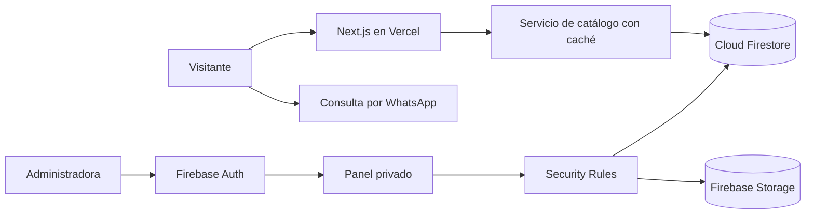

# KAJÚ Web

[](https://github.com/D1egoOQuintana/kajuu-web/actions/workflows/quality.yml)
[](https://nextjs.org/)
[](https://www.typescriptlang.org/)
[](https://firebase.google.com/)

Catálogo digital y panel de administración privado para **KAJÚ Indumentaria**, una boutique de moda femenina. El producto prioriza descubrimiento, identidad de marca y conversión asistida por WhatsApp; no implementa carrito, pagos ni cuentas de clientes.

**Producción:** [kajuu-web.vercel.app](https://kajuu-web.vercel.app)

**Catálogo:** [kajuu-web.vercel.app/catalogo](https://kajuu-web.vercel.app/catalogo)


## Producto

KAJÚ Web resuelve dos necesidades concretas:

- ofrecer una experiencia pública cálida, editorial y mobile-first;
- permitir que la propietaria gestione el catálogo sin exponer herramientas administrativas al público.

El recorrido principal es simple: explorar prendas, revisar variantes y disponibilidad, y abrir una consulta de WhatsApp con el producto ya identificado.

### Funcionalidades públicas

- portada editorial con selección de productos;
- catálogo filtrable por categoría, novedades y precio;
- fichas de producto con galería, colores, talles y estado de stock;
- lookbook de inspiración;
- guía para tomar medidas;
- contacto, preguntas frecuentes y proceso de compra;
- enlaces de WhatsApp con mensajes contextualizados;
- metadata, sitemap, robots y datos estructurados para SEO.

### Administración

- acceso privado con Firebase Authentication;
- autorización mediante custom claim `admin`;
- creación, edición, visibilidad y eliminación de productos;
- gestión de destacados, novedades y disponibilidad;
- carga de imágenes con validación de tipo, tamaño, ruta y permisos;
- revalidación del catálogo público después de cada cambio.

No existe ningún enlace público al panel y conocer su URL no concede acceso a los datos.

## Vista mobile

<p align="center">
  
</p>

## Arquitectura



Las páginas públicas leen Firestore desde el servidor y cachean resultados durante 60 segundos. El panel utiliza el SDK web autenticado; Firestore y Storage vuelven a validar cada operación mediante reglas, independientemente del estado de la interfaz.

### Organización del código

```txt
src/
  app/                         rutas, metadata y composición
  components/                  interfaz reutilizable
  features/catalog/            consultas públicas de productos
  features/admin-products/     operaciones administrativas
  features/auth/               sesión y autorización del panel
  lib/firebase/                inicialización client y server
  lib/validators/              esquemas Zod
  types/                       modelo de producto
tests/
  unit/                        validación y utilidades
  rules/                       pruebas de Firestore y Storage
```

## Decisiones técnicas

- **Server Components para el catálogo:** reduce JavaScript en el cliente y evita lecturas públicas repetidas.
- **Consultas específicas e indexadas:** catálogo, categorías y novedades no dependen de cargar toda la colección.
- **Documento por slug:** permite URLs legibles y búsquedas directas sin consultas adicionales.
- **Zod y Security Rules:** la validación de producto existe tanto en la aplicación como en la frontera de datos.
- **Custom claims para administración:** los permisos no dependen de emails hardcodeados ni de campos editables por usuarios.
- **CSP con nonce:** limita la ejecución de scripts y complementa los headers de seguridad.
- **Fallback local explícito:** los mocks facilitan desarrollo, pero nunca reemplazan silenciosamente a Firestore en producción.

## Seguridad

- lectura pública limitada a productos con `isVisible == true`;
- escrituras permitidas solo con `request.auth.token.admin == true`;
- esquema estricto y límites para strings, listas, imágenes, precios y timestamps;
- `createdAt` y slug protegidos contra modificaciones indebidas;
- uploads limitados a imágenes dentro de `products/{productId}/{fileName}`;
- resto de colecciones y rutas de Storage denegadas por defecto;
- Firebase Admin aislado en código server-only;
- `.env.local`, service accounts y archivos privados ignorados por Git.

Las reglas se prueban con Firebase Emulator Suite mediante casos permitidos y ataques de lectura, escritura, schema pollution, actualización inválida, rutas inseguras y archivos no admitidos.

## Stack

- Next.js 16 y App Router
- React 19
- TypeScript strict
- Tailwind CSS 4
- Firebase Auth
- Cloud Firestore
- Firebase Storage
- Firebase Admin SDK
- Zod
- Vitest y Firebase Rules Unit Testing
- Vercel

## Desarrollo local

### Requisitos

- Node.js 22
- Java 17 para Firebase Emulator Suite
- un proyecto Firebase con Authentication, Firestore y Storage habilitados

### Instalación

```bash
git clone https://github.com/D1egoOQuintana/kajuu-web.git
cd kajuu-web
npm ci
```

Copia `.env.example` como `.env.local` y completa la configuración. Las variables `NEXT_PUBLIC_*` llegan al navegador; las credenciales `FIREBASE_*` son exclusivamente server-side.

```bash
npm run dev
```

El sitio queda disponible en `http://localhost:3000`. Si Firebase Admin todavía no está configurado, el entorno de desarrollo utiliza el catálogo local. Producción falla de forma explícita ante una configuración incompleta y nunca muestra productos mock por accidente.

## Variables de entorno

```txt
NEXT_PUBLIC_SITE_URL
NEXT_PUBLIC_WHATSAPP_PHONE
NEXT_PUBLIC_FIREBASE_API_KEY
NEXT_PUBLIC_FIREBASE_AUTH_DOMAIN
NEXT_PUBLIC_FIREBASE_PROJECT_ID
NEXT_PUBLIC_FIREBASE_STORAGE_BUCKET
NEXT_PUBLIC_FIREBASE_MESSAGING_SENDER_ID
NEXT_PUBLIC_FIREBASE_APP_ID
NEXT_PUBLIC_FIREBASE_MEASUREMENT_ID
NEXT_PUBLIC_FIREBASE_APP_CHECK_SITE_KEY

FIREBASE_PROJECT_ID
FIREBASE_CLIENT_EMAIL
FIREBASE_PRIVATE_KEY
```

No confirmes `.env.local`, credenciales de Firebase Admin ni archivos de service account.

## Comandos

| Comando | Uso |
| --- | --- |
| `npm run dev` | servidor de desarrollo |
| `npm run lint` | análisis estático |
| `npm test` | pruebas unitarias |
| `npm run test:rules` | pruebas de Firestore y Storage con emuladores |
| `npm run build` | build de producción y verificación TypeScript |
| `npm run check` | lint, pruebas unitarias, reglas y build |
| `npm run audit:prod` | auditoría de dependencias de producción |
| `npm run admin:grant -- correo@dominio.com` | concede el custom claim de administrador |
| `npm run seed:products` | carga controlada del catálogo inicial |

## Preparación de Firebase

1. Habilita Email/Password en Firebase Authentication.
2. Configura las variables privadas del Admin SDK.
3. Despliega índices y reglas antes de publicar código que dependa de las nuevas consultas:

```bash
npx firebase-tools deploy --only firestore:rules,firestore:indexes,storage
```

4. Crea la cuenta propietaria y concede el claim desde un entorno seguro:

```bash
npm run admin:grant -- correo@dominio.com
```

La persona administradora debe volver a iniciar sesión para renovar su token.

## Calidad continua

El workflow de GitHub Actions ejecuta, para cada push y pull request:

1. instalación reproducible con `npm ci`;
2. auditoría de dependencias de producción;
3. ESLint;
4. pruebas unitarias;
5. pruebas de reglas con emuladores;
6. build de producción y TypeScript.

## Alcance

Esta versión no almacena datos personales de clientes y no incluye carrito, checkout, pagos ni cuentas públicas. Las ventas se coordinan de forma manual por WhatsApp, de acuerdo con el flujo real del negocio.

Los recursos de marca pertenecen a KAJÚ Indumentaria. Las atribuciones de recursos externos se documentan en [`THIRD_PARTY_NOTICES.md`](THIRD_PARTY_NOTICES.md).
